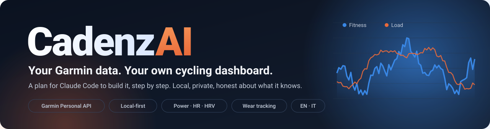
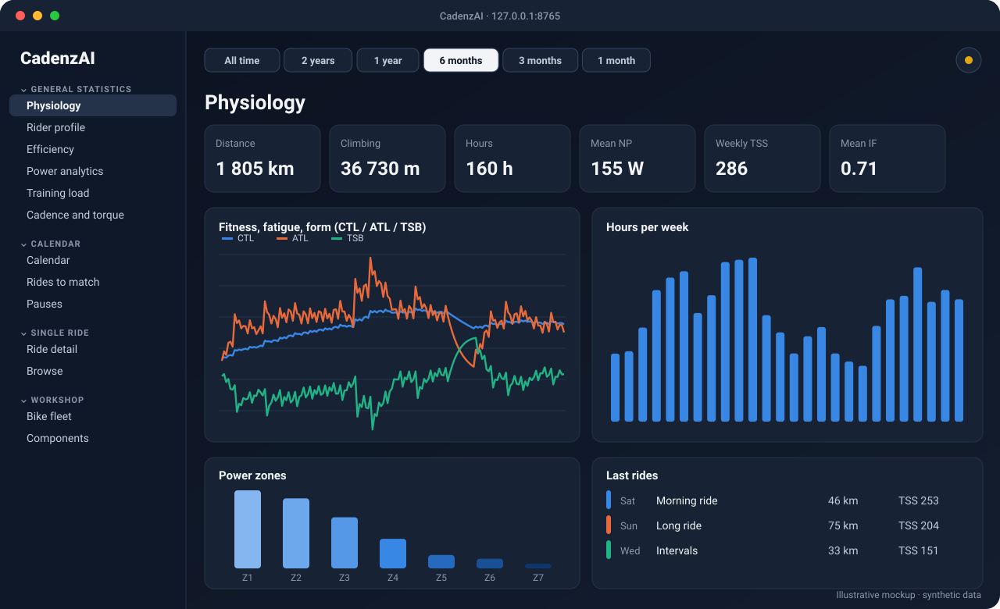
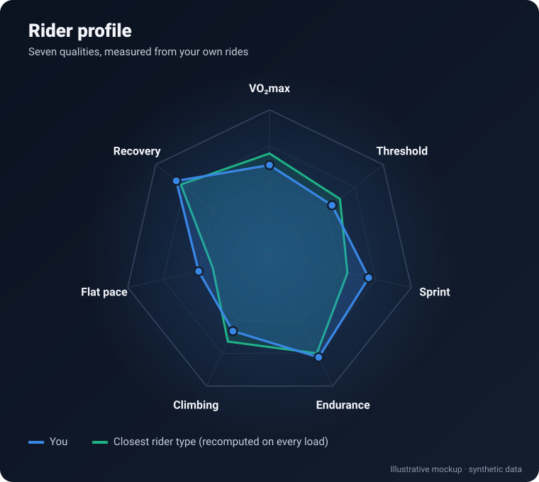
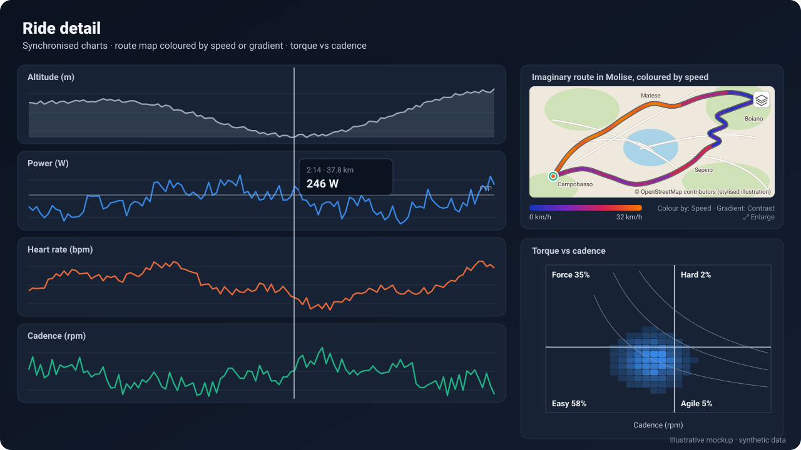
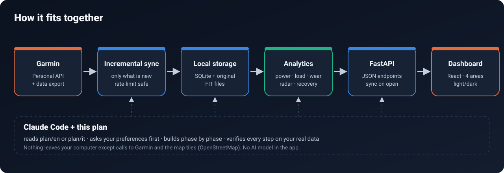

<div align="center">



[English](README.md) · **Italiano**

</div>

# CadenzAI

> **Un plan per [Claude Code](https://www.anthropic.com/claude-code) che costruisce, passo dopo passo, la tua dashboard ciclistica locale a partire dai tuoi dati Garmin.**
> Questo repository **non contiene l'app**: contiene la *specifica*. La scarichi, la adatti ai tuoi gusti, la dai a Claude Code e lui costruisce *la tua* dashboard sul *tuo* computer.

<p align="center">
  <br/>
  <sub>Mockup illustrativo, dati sintetici. In questo repository non ci sono uscite reali.</sub>
</p>

## Perché un plan e non un'app?

Ognuno ha bici, sensori e curiosità diversi. Un plan lo puoi **leggere, modificare e rieseguire**: togli una pagina, cambi una soglia, traduci l'interfaccia, aggiungi una tua metrica, e Claude Code ricostruisce l'app di conseguenza. Il plan racconta anche *gli errori già fatti* (campi sbagliati, trabocchetti sulle unità, un filtro troppo aggressivo…) così la tua versione non li ripete.

## Cosa fa l'app finita

- **Scarica da sola uscite e dati dell'orologio da Garmin**, solo il nuovo, a ogni apertura della pagina (potenza, frequenza cardiaca, file FIT originali, sonno, HRV, FC a riposo, Body Battery).
- **Quattro aree:** Statistiche generali · Calendario · Singola uscita · Officina (bici e componenti).
- **Radar del profilo del ciclista** con sette qualità (VO₂max, soglia, sprint, resistenza, salita, passo in pianura, recupero) e confronto con i tipi di ciclista.
- **Dettaglio uscita:** grafici sincronizzati, tracciato disegnato in locale (senza mappe online), giri, zone, migliori sforzi, mappa coppia-cadenza, disaccoppiamento aerobico.
- **Parco bici e usura dei componenti:** soglie *e* un indice d'usura che tiene conto del percorso (i freni si consumano in discesa, la catena col lavoro in pedalata), avvisi all'80% e al 100%, bici abbinate alle uscite in automatico.
- **Onesta per progetto:** non inventa mai un valore mancante, etichetta ogni stima, separa osservazione, ipotesi e raccomandazione.
- **Privata per progetto:** tutto resta sul tuo computer. Escono solo le chiamate a Garmin.

<p align="center">
  
  
</p>

## Come si incastra tutto

<p align="center"></p>

Stack della versione di riferimento: Python 3.12 · FastAPI · SQLite · `fitparse` · NumPy/SciPy · React · Vite · Recharts. Puoi chiedere a Claude Code un altro stack: il plan descrive *cosa* costruire, non solo *come*.

## Cosa c'è in questo repository

```text
plan/en/   il plan in inglese (00 … 09)
plan/it/   il plan in italiano (00 … 09)
docs/images/   illustrazioni usate in questo README (dati sintetici)
CLAUDE.md  istruzioni iniziali che Claude Code legge da solo
```

| File | Contenuto |
|---|---|
| `00-overview` | obiettivo, regole di lavoro, le domande che Claude ti fa, fasi e controlli di accettazione |
| `01-data-sources` | API Personal di Garmin, gestione della chiave, export, sicurezza, conservazione dei dati |
| `02-data-model` | schema SQLite e formato dei flussi |
| `03-ingestion-and-sync` | importazione, decodifica FIT, sincronizzazione all'apertura, limiti di richieste, trabocchetti |
| `04-metrics-and-formulas` | ogni formula con parametri e controlli di validità |
| `05-bikes-and-components` | parco bici, abbinamento automatico, usura e soglie |
| `06-pages-and-ux` | menu, ogni pagina, regole di design e accessibilità |
| `07-operations-and-quality` | server, `start.sh`, protocollo di test, lezioni apprese |
| `08-roadmap-and-comparison` | confronto con GoldenCheetah, funzioni candidate, cosa non si fa |
| `09-reference-data` | modello di configurazione, tabella dei percentili, colori, campi FIT |

I file hanno **gli stessi nomi in inglese e in italiano**, così i rimandi (per esempio «vedi `05`») valgono in entrambe le lingue.

---

## Requisiti

- **Claude Code** installato e con l'accesso effettuato.
- **Python 3.12+** e **Node.js 20+** (con `npm`).
- Un account **Garmin** con le tue uscite su **Garmin Connect** (orologio o ciclocomputer). Un misuratore di potenza e una fascia cardio sono molto consigliati; senza, il plan funziona comunque (N/D).
- Linux, macOS o **Windows 10/11** (la versione di riferimento è stata sviluppata e verificata su Linux). Su Windows puoi usare **WSL 2** (la via più semplice: segui i comandi Linux nel terminale Ubuntu) oppure lavorare in modo nativo con **PowerShell**; qui sotto trovi entrambe le strade. Installa Python e Node.js su Windows con `winget install Python.Python.3.12 OpenJS.NodeJS.LTS` e Claude Code dalle istruzioni ufficiali.
- Facoltativo: Google Chrome, per le verifiche nel browser che Claude può fare da solo.

## Passo dopo passo

### 1 · Ottieni la chiave dell'API Personal di Garmin

L'**API Personal** di Garmin Connect dà a *te*, e solo a te, accesso in lettura ai *tuoi* dati con una sola chiave. Nessuna richiesta di autorizzazione.

1. Accedi a Garmin Connect da browser: <https://connect.garmin.com>.
2. Apri la pagina **Personal API token**: <https://connect.garmin.com/app/settings/personalApiToken> (dall'app web: menu del profilo → *Impostazioni* → *Personal API token*; i nomi dei menu possono cambiare).
3. Crea una chiave e scegli la **durata più lunga** disponibile (fino a un anno; metti un promemoria in calendario).
4. **Copiala subito: Garmin la mostra una volta sola.** Se la perdi, ne crei un'altra.

> Garmin sta cambiando la sua offerta per sviluppatori. Se la pagina non è disponibile per te, dillo a Claude: il plan ha un'alternativa basata sull'*export dei dati* di Garmin (passo 3), senza aggiornamenti automatici.

### 2 · Conserva la chiave in modo sicuro (mai nella cartella del progetto)

```bash
mkdir -p ~/.config/garmin && chmod 700 ~/.config/garmin
read -rs -p "Incolla la chiave Garmin (non verrà mostrata): " KEY && echo
printf '%s' "$KEY" > ~/.config/garmin/connect-personal-api-key && unset KEY
chmod 600 ~/.config/garmin/connect-personal-api-key
ls -l ~/.config/garmin/connect-personal-api-key      # deve mostrare -rw-------
```

**Windows (PowerShell):**

```powershell
$dir = "$env:USERPROFILE\.config\garmin"; New-Item -ItemType Directory -Force $dir | Out-Null
$k = Read-Host "Incolla la chiave Garmin (non verrà mostrata)" -AsSecureString
[Runtime.InteropServices.Marshal]::PtrToStringAuto([Runtime.InteropServices.Marshal]::SecureStringToBSTR($k)) | Set-Content -NoNewline "$dir\connect-personal-api-key"
icacls "$dir\connect-personal-api-key" /inheritance:r /grant:r "${env:USERNAME}:(R,W)"   # solo tu
icacls "$dir\connect-personal-api-key"                                                     # verifica: compare solo il tuo utente
```

Regole che il plan impone: la chiave **non viene mai stampata, registrata nei log, inclusa in un commit o inviata a qualcuno che non sia Garmin**. Se per errore viene mostrata, revocala e creane una nuova.

### 3 · (Consigliato) Richiedi l'export dei tuoi dati Garmin

Ti dà lo **storico, tutti i file FIT senza doverli riscaricare e il legame tra ogni uscita e la sua bici** (l'API non espone le bici).

1. Garmin Connect → **Account** → **Gestione dati** → **Esporta i tuoi dati** (le diciture possono variare).
2. Garmin ti manda per e-mail un link di download (può richiedere ore o giorni).
3. Decomprimilo in una cartella come `~/garmin-export` e comunica a Claude quel percorso quando te lo chiede.

### 4 · (Facoltativo) Installa un server MCP per esplorare i dati Garmin da Claude

Un **server MCP** permette a Claude di interrogare Garmin direttamente mentre chiacchieri. **Non serve** all'app finita (il backend dell'app chiama da solo l'API Garmin), ma è utile per *esplorare i dati e controllare i valori* durante la costruzione.

La versione di riferimento ha usato **`garmin-personal-mcp`** (sola lettura, API Personal ufficiale, gira in locale con `npx`):

```bash
claude mcp add garmin-personal -- npx -y garmin-personal-mcp@0.1.1
```

Legge la chiave da `~/.config/garmin/connect-personal-api-key` (passo 2). Riavvia Claude Code dopo l'installazione.

**Note di sicurezza (leggile):**
- È un progetto di terzi (<https://github.com/Shape-Calendar/garmin-personal-mcp>) che riceve la tua chiave. L'autore del plan ha **verificato la versione 0.1.1 il 20/11/2026**: circa 960 righe di TypeScript, la chiave viene inviata solo al server di Garmin, il pacchetto pubblicato corrispondeva al sorgente, nessuno script di installazione. Le sue **dipendenze non sono state verificate**.
- **Fissa la versione** come sopra (non usare «latest») e **ricontrolla il codice prima di aggiornare**.
- Esistono altri server MCP (varie implementazioni di `garmin-personal-mcp`; una con cache SQLite locale). Qualunque tu scelga: leggi prima il codice, verifica che le chiamate di rete vadano solo a Garmin, preferisci la sola lettura.
- Evita i server che chiedono **e-mail e password** di Garmin (accesso non ufficiale): questo plan non ne ha bisogno.

**Facoltativo, per la verifica visiva:** un MCP per l'automazione del browser (per esempio *Chrome DevTools MCP*) permette a Claude di aprire la tua dashboard, scorrere tutte le pagine, intercettare gli errori in console e fare screenshot. Per installarlo segui il README di quel progetto; il protocollo di verifica del plan (`plan/it/07-operations-and-quality.md`) lo usa se disponibile, altrimenti ti chiede di controllare tu le pagine.

### 5 · Avvia Claude Code con il plan

```bash
mkdir my-cadenzai && cd my-cadenzai
git clone https://github.com/rekhyt75/CadenzAI.git _plan
cp -r _plan/plan _plan/CLAUDE.md .      # il plan + il file iniziale
claude
```

Windows (PowerShell):

```powershell
mkdir my-cadenzai; cd my-cadenzai
git clone https://github.com/rekhyt75/CadenzAI.git _plan
Copy-Item -Recurse _plan\plan, _plan\CLAUDE.md .      # il plan + il file iniziale
claude
```

Poi di' a Claude, per esempio:

> *Leggi `CLAUDE.md` e `plan/it/00-overview.md`, poi segui il plan. Fammi prima le domande di personalizzazione e verifica ogni fase sui miei dati reali prima di passare alla successiva. Rispondi in italiano.*

### 6 · Cosa farà Claude

1. Rivedrà il plan, elencherà le contraddizioni e ti farà un breve giro di domande (lingua, peso, frequenza cardiaca massima, bici, come accedere a Garmin, periodo predefinito…).
2. Costruirà in **fasi da 0 a 12** (ambiente → accesso a Garmin → modello dei dati → metriche → API → struttura del frontend → pagine → bici e usura → benessere → calendario e pause → dettaglio uscita → radar → operazioni), eseguendo alla fine di ognuna **controlli di accettazione sui tuoi dati**.
3. Ti dirà con onestà cosa ha verificato, cosa non ha potuto verificare e cosa è fallito.

La prima importazione di uno storico lungo può richiedere tempo perché Garmin limita le richieste; l'importatore è **riprendibile**.

### 7 · Uso quotidiano

```bash
./start.sh start      # http://127.0.0.1:8765
./start.sh status     # attivo? da quanto? l'aggiornamento da Garmin è finito?
./start.sh logs 50    # ultime righe del log (senza numero: lo segue)
./start.sh restart    # dopo modifiche al codice
./start.sh stop
```

Su Windows nativo Claude Code costruisce un equivalente PowerShell, `start.ps1` (stessi comandi; vedi `plan/it/07-operations-and-quality.md` §2.1):

```powershell
.\start.ps1 start      # http://127.0.0.1:8765  (la prima volta: Set-ExecutionPolicy -Scope CurrentUser RemoteSigned)
.\start.ps1 status
.\start.ps1 logs 50
.\start.ps1 restart
.\start.ps1 stop
```

Apri la pagina: l'app chiede a Garmin **solo il nuovo** e ti mostra cosa manca nelle uscite nuove (niente potenza, niente FC, una bici da confermare).

## Personalizzare il plan

Fai un fork del repository e modifica i file in `plan/`: cambia le pagine, le soglie, gli assi del radar, le forme dei tipi di ciclista, i colori, la lingua. Mantieni per ogni metrica *parametri*, etichetta *stima/misura* e *controllo di validità*: sono ciò che tiene onesto il risultato. Le idee non ancora realizzate sono in `plan/it/08-roadmap-and-comparison.md`.

## Privacy e sicurezza in breve

- Tutto è salvato **in locale** (SQLite + file FIT originali). Non viene caricato nulla.
- **Nessuna mappa online**: il percorso è disegnato in locale dai tuoi punti GPS.
- Export, ZIP e file FIT sono trattati come **input non fidato**.
- **Non** pubblicare il tuo database, i file FIT, l'export o la chiave. Se condividi la tua versione, condividi solo il codice.

## Risoluzione dei problemi

| Sintomo | Causa probabile e rimedio |
|---|---|
| L'elenco delle attività è vuoto | l'API **richiede** `endDate`: assicurati di inviare entrambe le date |
| `HTTP 429` | limite di richieste di Garmin: l'importatore aspetta e riprova; lascialo lavorare (o rilancialo più tardi) |
| `HTTP 401` dopo mesi | la chiave è scaduta: creane una nuova (passo 1) e sostituisci il file |
| `HTTP 404` sugli endpoint delle bici | normale: l'API non espone le bici; usa l'export e l'abbinamento automatico |
| Una pagina resta su «Caricamento…» | un endpoint dell'API ha risposto HTML invece di JSON (una rotta è stata rimossa): esegui il test di tutti gli endpoint |
| `start.sh` dice che la porta è occupata | la usa un altro programma; scegline un'altra con `<APP>_PORT=8800 ./start.sh start` (PowerShell: `$env:<APP>_PORT=8800; .\start.ps1 start`) |
| Windows: «l'esecuzione di script è disabilitata» | `Set-ExecutionPolicy -Scope CurrentUser RemoteSigned`, poi riesegui |
| Una pagina di prodotto è bloccata («protezione anti-bot») | non aggirarla: aprila nel tuo browser e incolla la scheda tecnica, o usa un'altra fonte pubblica |

## Limiti onesti

- L'app finita **non contiene modelli di intelligenza artificiale**: il «Coach» è a regole. Il nome è un richiamo al modo in cui viene costruita.
- Soglie, indici d'usura, salite, FTP e potenza critica, punteggi del radar e forme dei tipi di ciclista sono **stime o ipotesi**, etichettate come tali. I migliori sforzi in uscita non sono test.
- Il riferimento dei percentili è una tabella generica di popolazione (non corretta per età o disciplina).
- Garmin può cambiare la sua API in qualsiasi momento. Il plan elenca cosa ricontrollare.
- È un progetto personale, **non affiliato né approvato da Garmin o da Anthropic**. *Garmin* e *Garmin Connect* sono marchi di Garmin Ltd. o delle sue società controllate.

## Licenza

Apache License 2.0: vedi [LICENSE](LICENSE).
