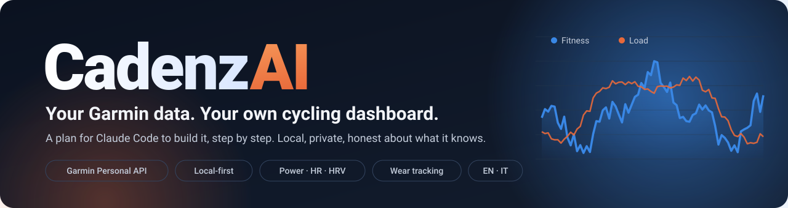
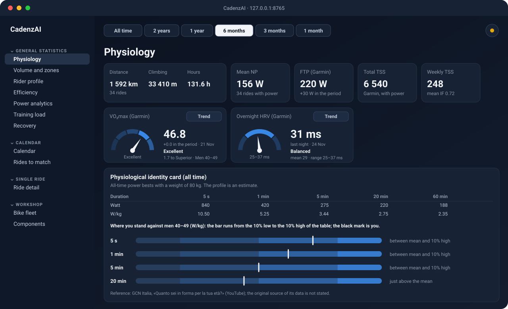
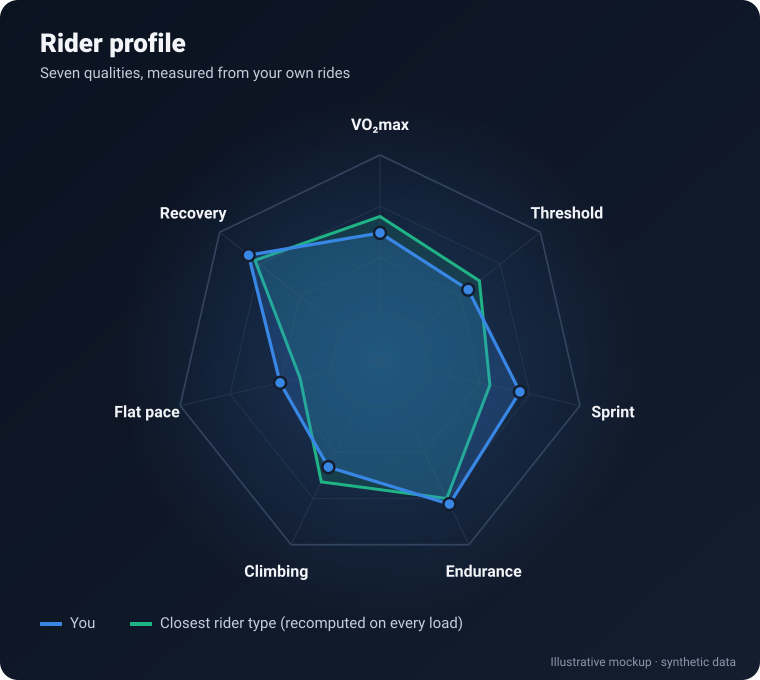
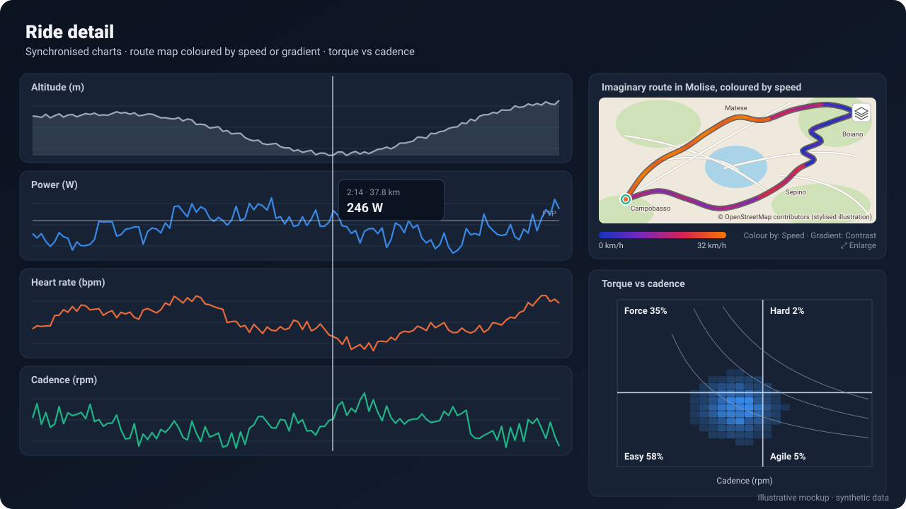
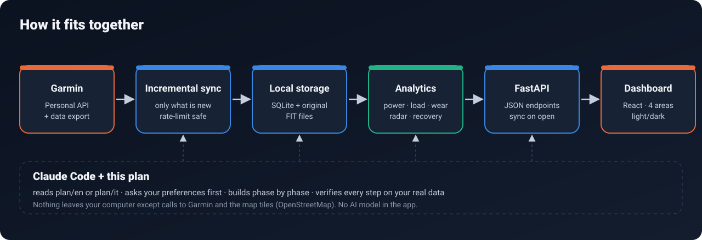

<div align="center">



**English** · [Italiano](README.it.md)

</div>

# CadenzAI

> **A plan for [Claude Code](https://www.anthropic.com/claude-code) that builds, step by step, your own local cycling-analytics dashboard from your own Garmin data.**
> This repository contains **no app**: it contains the *specification*. You download it, adapt it to your taste, point Claude Code at it, and it builds *your* dashboard on *your* computer.

<p align="center">
  <br/>
  <sub>Illustrative mockup, synthetic data. No real rides are shown in this repository.</sub>
</p>

> ### ⚡ The real value: you start from the answer, not from the question
> This plan is **not a first draft**. It is what is left after a long, real build on real Garmin data: every wrong turn, correction, test and analysis made along the way is already folded into the specification, so Claude Code does not have to rediscover any of it. **That is what saves you time and tokens.**
>
> **What you skip**
> - **Exploring the Garmin API:** which endpoints answer and which return 404 (the gear), the mandatory `endDate`, the rate limits, and metrics that look missing but are not (VO₂max).
> - **The dead ends of the data:** UTC times, a flag bit hidden in the left/right balance, a spike filter that had to be tuned twice, export fields that mislead, how to match FIT files to rides.
> - **The decisions that took many rounds:** wear thresholds and honest wording, a bike-value model with a cited source, gauges against your own range, what a small local AI can and cannot be trusted with (five models were compared), a layout that does not jump around.
> - **The checks:** what to verify after every phase, and the ways it already failed. Sixteen groups of lessons are written down (`plan/en/07-operations-and-quality.md`).
>
> **What you still pay for:** reading the plan once (about 110,000 characters, roughly 27,000 tokens), the code that Claude Code has to write, and your own choices. The plan removes the *discovery*, not the *building*.
>
> **A rough estimate, not a measurement:** we expect this to save on the order of **half of the tokens and of the back-and-forth** compared with starting from a blank page. To measure it, run the plan in an empty folder and compare the usage with your own from-scratch attempt. And every correction you make later can go back into the plan, so the next person starts even further ahead.

## Why a plan and not an app?

> ### 🔒 Privacy first
> **Your data stays on your PC.** Most online cycling services upload your rides, heart rate, sleep and routes to their own servers, where they are stored, analysed and often shared or monetised. CadenzAI does the opposite: the database and your original FIT files live **only on your computer**, the dashboard runs **only on your machine** (`127.0.0.1`), and nothing is uploaded anywhere. The only connections are the ones you can see and switch off: **Garmin** (to fetch *your own* data with *your own* key) and the **map tiles** (OpenStreetMap sees which area you look at, never your ride data; an offline view is one click away). No accounts, no tracking, no ads.

Everyone rides different bikes, owns different sensors and wants different statistics. A plan is something you can **read, edit and re-run**: remove a page, change a threshold, translate the interface, add your own metric — and Claude Code rebuilds the app accordingly. The plan also records the *mistakes already made* (wrong fields, unit traps, a filter that was too aggressive…) so that your build does not repeat them.

## What the finished app does

- **Pulls your rides and watch data from Garmin automatically**, only what is new, every time you open the page (power, heart rate, original FIT files, sleep, HRV, resting HR, Body Battery).
- **Four areas:** General statistics · Calendar · Single ride · Workshop (bikes and components), plus an icon next to the title that opens your profile.
- **Physiology page that fits one screen:** VO₂max and overnight HRV as speedometer-style gauges (with a trend window and the shaded balanced range for HRV), FTP, and an identity card that compares your best efforts with age- and sex-based tables (cited, see `plan/en/04-metrics-and-formulas.md` §15).
- **Your profile lives in the database, never in the code:** a "User profile" window opened from an icon next to the title (sex, birth date, weight, maximum heart rate, which it can read from Garmin), and a "Stress and sleep" page with stress hours, breathing, Garmin's sleep classes and fitness age.
- **Rider profile radar** with seven qualities (VO₂max, threshold, sprint, endurance, climbing, flat pace, recovery) and a comparison with rider types.
- **Ride detail:** synchronised charts, route on an OpenStreetMap map you can colour by speed, gradient, power, heart rate… (with an offline fallback), laps, zones, best efforts, torque-vs-cadence map, aerobic decoupling.
- **Bike fleet and component wear:** thresholds *and* a route-aware wear index (brakes wear on descents, chains on pedalling work), alerts at 80 % and 100 %, bikes matched to rides automatically.
- **Optional AI summary of a ride, 100 % local:** a robot button writes a short summary with a language model that runs on your own computer (Ollama on `127.0.0.1`). It is **off unless you say yes**; see `plan/en/10-optional-local-ai.md`.
- **Honest by design:** it never invents a missing value, labels every estimate, separates observation, hypothesis and recommendation.
- **Private by design:** everything stays on your computer. Only calls to Garmin leave it.

<p align="center">
  
  
</p>

## How it fits together

<p align="center"></p>

Stack of the reference build: Python 3.12 · FastAPI · SQLite · `fitparse` · NumPy/SciPy · React · Vite · Recharts. You may ask Claude Code for another stack: the plan describes *what* to build, not only *how*.

## What's in this repository

```text
plan/en/   the plan in English (00 … 10)
plan/it/   il plan in italiano (00 … 10)
docs/images/   illustrations used in this README (synthetic data)
CLAUDE.md  bootstrap instructions that Claude Code reads automatically
```

| File | Content |
|---|---|
| `00-overview` | goal, working rules, the questions Claude asks you, phases and acceptance checks |
| `01-data-sources` | Garmin Personal API, key handling, export, security, retention |
| `02-data-model` | SQLite schema and stream format |
| `03-ingestion-and-sync` | import, FIT decoding, sync-on-open, rate limits, pitfalls |
| `04-metrics-and-formulas` | every formula with parameters and validation checks |
| `05-bikes-and-components` | bike fleet, automatic bike matching, wear and thresholds |
| `06-pages-and-ux` | menu, every page, design and accessibility rules |
| `07-operations-and-quality` | server, `cadenzAI.sh`, testing protocol, lessons learned |
| `08-roadmap-and-comparison` | comparison with GoldenCheetah, candidate features, non-goals |
| `09-reference-data` | config template, percentile table, colours, FIT fields |
| `10-optional-local-ai` | **optional** local-AI ride summary (asked first, off by default) |

---

## Requirements

- **Claude Code** installed and logged in.
- **Python 3.12+** and **Node.js 20+** (with `npm`).
- A **Garmin** account with your rides in **Garmin Connect** (watch or bike computer). A power meter and a heart-rate strap are strongly recommended; the plan degrades gracefully (N/D) without them.
- Linux, macOS or **Windows 10/11** (the reference build was developed and verified on Linux). On Windows you can either use **WSL 2** (simplest: then follow the Linux commands inside the Ubuntu terminal) or run natively with **PowerShell**; both are shown below. Install Python and Node.js on Windows with `winget install Python.Python.3.12 OpenJS.NodeJS.LTS` and Claude Code from its official instructions.
- Optional: Google Chrome, for the browser-based verification Claude can run on its own.

## Step by step

### 1 · Get your Garmin Personal API key

The Garmin Connect **Personal API** gives *you*, and only you, read access to *your own* data with a single key. No application form.

1. Log in to Garmin Connect in a browser: <https://connect.garmin.com>.
2. Open the **Personal API token** page: <https://connect.garmin.com/app/settings/personalApiToken> (from the web app: profile menu → *Settings* → *Personal API token*; menu names may change).
3. Create a key and pick the **longest lifetime** offered (up to one year; put a reminder in your calendar).
4. **Copy it immediately: Garmin shows it only once.** If you lose it, create a new one.

> Garmin has been changing its developer offering. If the page is not available to you, tell Claude: the plan has a fallback based on the Garmin *data export* (see step 2), without automatic updates.

### 2 · Store the key safely (never in the project folder)

```bash
mkdir -p ~/.config/garmin && chmod 700 ~/.config/garmin
read -rs -p "Paste the Garmin key (hidden): " KEY && echo
printf '%s' "$KEY" > ~/.config/garmin/connect-personal-api-key && unset KEY
chmod 600 ~/.config/garmin/connect-personal-api-key
ls -l ~/.config/garmin/connect-personal-api-key      # must show -rw-------
```

**Windows (PowerShell):**

```powershell
$dir = "$env:USERPROFILE\.config\garmin"; New-Item -ItemType Directory -Force $dir | Out-Null
$k = Read-Host "Paste the Garmin key (hidden)" -AsSecureString
[Runtime.InteropServices.Marshal]::PtrToStringAuto([Runtime.InteropServices.Marshal]::SecureStringToBSTR($k)) | Set-Content -NoNewline "$dir\connect-personal-api-key"
icacls "$dir\connect-personal-api-key" /inheritance:r /grant:r "${env:USERNAME}:(R,W)"   # only you
icacls "$dir\connect-personal-api-key"                                                     # check: only your user listed
```

Rules the plan enforces: the key is **never printed, logged, committed or sent anywhere except to Garmin**. If it is ever displayed by mistake, revoke it and create a new one.

### 3 · (Recommended) Request your Garmin data export

It gives you your **history, every FIT file without re-downloading them, and the link between each ride and its bike** (the API does not expose bikes).

1. Garmin Connect → **Account** → **Data management** → **Export your data** (wording may vary).
2. Garmin emails you a download link (it can take hours or days).
3. Unzip it into a folder such as `~/garmin-export` and give that path to Claude when it asks.

### 4 · (Optional) Install an MCP server to explore your Garmin data from Claude

An **MCP server** lets Claude query Garmin directly while you chat. It is **not needed** by the finished app (the app's backend calls the Garmin API itself), but it is useful to *explore the data and check values* while building.

The reference build used **`garmin-personal-mcp`** (read-only, official Personal API, runs locally via `npx`):

```bash
claude mcp add garmin-personal -- npx -y garmin-personal-mcp@0.1.1
```

It reads the key from `~/.config/garmin/connect-personal-api-key` (step 2). Restart Claude Code afterwards.

**Security notes (please read):**
- It is a third-party project (<https://github.com/Shape-Calendar/garmin-personal-mcp>) that receives your key. The plan's author **audited version 0.1.1 on 20 Nov 2026**: about 960 lines of TypeScript, the key is sent only to Garmin's host, the published package matched the source, no install scripts. Its **dependencies were not audited**.
- **Pin the version** as above (do not use "latest") and **re-audit before upgrading**.
- Other MCP servers exist (several `garmin-personal-mcp` implementations; one that keeps a local SQLite cache). Whatever you choose: read the code first, check that the network calls only go to Garmin, prefer read-only.
- Avoid servers that ask for your Garmin **email and password** (unofficial login): this plan does not need them.

**Optional, for visual verification:** a browser-automation MCP (for example *Chrome DevTools MCP*) lets Claude open your dashboard, click through every page, catch console errors and take screenshots. Follow that project's own README to install it; the plan's verification protocol (`plan/en/07-…`) uses it if available and otherwise asks you to check the pages yourself.

### 5 · Start Claude Code with the plan

```bash
mkdir my-cadenzai && cd my-cadenzai
git clone https://github.com/rekhyt75/CadenzAI.git _plan
cp -r _plan/plan _plan/CLAUDE.md .      # the plan + the bootstrap file
claude
```

Windows (PowerShell):

```powershell
mkdir my-cadenzai; cd my-cadenzai
git clone https://github.com/rekhyt75/CadenzAI.git _plan
Copy-Item -Recurse _plan\plan, _plan\CLAUDE.md .      # the plan + the bootstrap file
claude
```

Then tell Claude, for example:

> *Read `CLAUDE.md` and `plan/en/00-overview.md`, then follow the plan. Ask me the customisation questions first, and verify every phase on my real data before moving on.*

(Italian users: `plan/it/00-overview.md` — see the Italian README. The files have the same names in both languages.)

### 6 · What Claude will do

1. Review the plan, list contradictions and ask you a short round of questions (language, weight, max heart rate, bikes, how to access Garmin, default period…).
2. Build in **phases 0–12** (plus the optional phase 13 only if you ask for it) (environment → Garmin access → data model → metrics → API → frontend shell → pages → bikes and wear → wellness → calendar and pauses → ride detail → radar → operations), running **acceptance checks on your data** at the end of each.
3. Tell you honestly what it verified, what it could not, and what failed.

The first import of a long history can take a while because Garmin rate-limits requests; the importer is **resumable**.

### 7 · Everyday use

```bash
./cadenzAI.sh start      # http://127.0.0.1:8765
./cadenzAI.sh status     # running? since when? is the Garmin update done?
./cadenzAI.sh logs 50    # last log lines (no number = follow)
./cadenzAI.sh restart    # after code changes
./cadenzAI.sh ai status  # optional local AI model server (started together with the app if installed)
./cadenzAI.sh stop
```

On native Windows Claude Code builds a PowerShell equivalent, `cadenzAI.ps1` (same commands; see `plan/en/07-operations-and-quality.md` §2.1):

```powershell
.\cadenzAI.ps1 start      # http://127.0.0.1:8765  (first time: Set-ExecutionPolicy -Scope CurrentUser RemoteSigned)
.\cadenzAI.ps1 status
.\cadenzAI.ps1 logs 50
.\cadenzAI.ps1 restart
.\cadenzAI.ps1 stop
```

Open the page: the app asks Garmin only for **what is new**, and shows what is missing in the new rides (no power, no heart rate, a bike to confirm).

## Customising the plan

Fork the repository and edit the files in `plan/`: change the pages, the thresholds, the radar axes, the rider-type shapes, the colours, the language. Keep each metric's *parameters*, *estimate/measurement* label and *validation check*: they are what keeps the result honest. Ideas not yet built are in `plan/en/08-roadmap-and-comparison.md`.

## Privacy and security in short

- Everything is stored **locally** (SQLite + the original FIT files). Nothing is uploaded.
- **The only outside request besides Garmin** is the route map: OpenStreetMap tiles, so OSM sees the area you are viewing (never your ride data). A toggle switches to a fully offline drawing.
- Exports, ZIPs and FIT files are treated as **untrusted input**.
- Do **not** publish your database, FIT files, export or key. If you share your build, share the code only.

## Troubleshooting

| Symptom | Likely cause and fix |
|---|---|
| Activity list is empty | `endDate` is **required** by the API; make sure both dates are sent |
| `HTTP 429` | Garmin rate limit: the importer waits and retries; just let it run (or re-run later) |
| `HTTP 401` after months | the key expired: create a new one (step 1) and replace the file |
| `HTTP 404` on gear endpoints | normal: the API does not expose bikes; use the export and the automatic matching |
| A page stays on "Loading…" | an API endpoint returned HTML instead of JSON (a route was removed); run the endpoint smoke test |
| `cadenzAI.sh` says the port is busy | another program uses it; pick another with `<APP>_PORT=8800 ./cadenzAI.sh start` (PowerShell: `$env:<APP>_PORT=8800; .\cadenzAI.ps1 start`) |
| Windows: "running scripts is disabled" | `Set-ExecutionPolicy -Scope CurrentUser RemoteSigned`, then re-run |
| A product page is blocked ("bot protection") | do not bypass it: open it in your browser and paste the spec, or use another public source |

## Honest limits

- The finished app contains **no AI model by default**: the "Coach" is rule-based. The only AI is the **optional**, local ride summary (`plan/en/10-optional-local-ai.md`): a small model that can be wrong, clearly labelled, with its input data one click away. The name is a nod to the way the app is built.
- Thresholds, wear indices, climbs, FTP/critical power, the radar scores and the rider-type shapes are **estimates or hypotheses**, labelled as such. Best efforts in rides are not tests.
- The percentile reference is a generic population table (not corrected for age or discipline).
- Garmin may change its API at any time. The plan lists what to re-verify.
- This is a personal project, **not affiliated with or endorsed by Garmin or Anthropic**. *Garmin* and *Garmin Connect* are trademarks of Garmin Ltd. or its subsidiaries.

## Credits

External data and tools the plan relies on. The plan cites them; this repository does not redistribute their data (the few reference tables it mentions must be read from the sources below, and each source's own terms apply).

| Used for | Source |
|---|---|
| Your own Garmin data (API and data export) | [Garmin Connect](https://connect.garmin.com), personal API key from [Settings](https://connect.garmin.com/app/settings/personalApiToken) |
| Optional conversational access to Garmin from Claude Code | [garmin-personal-mcp](https://github.com/Shape-Calendar/garmin-personal-mcp) (third-party: read its code before giving it your key) |
| VO₂max levels by sex and age (Cooper Institute classifications) | [Garmin, "VO₂max"](https://www.garmin.com/it-IT/blog/fitness/vo2max/) |
| Power by age and sex (5 s, 1 min, 5 min, 20 min) | [GCN Italia, "Quanto sei in forma per la tua età?"](https://www.youtube.com/watch?v=B3uTsYNu8V0) (YouTube). The original study is not stated in the video |
| Power-profile percentiles for the rider radar | [Adapt Cycling, power profile](https://www.adaptcycling.com/tools/power-profile) (the page does not name its dataset) |
| Used-bike value by age | [buycycle, "Quanto posso vendere la mia bici?"](https://buycycle.com/blog/it/post/quanto-posso-vendere-la-mia-bici/) |
| Route map tiles | [OpenStreetMap](https://www.openstreetmap.org/copyright) (© OpenStreetMap contributors), [CyclOSM](https://www.cyclosm.org), [OpenTopoMap](https://opentopomap.org), [Humanitarian OpenStreetMap Team](https://www.hotosm.org); map library [Leaflet](https://leafletjs.com) |
| Optional local AI summary | [Ollama](https://ollama.com) and the [Qwen 3 model](https://ollama.com/library/qwen3) |

## License

Apache License 2.0: see [LICENSE](LICENSE).
